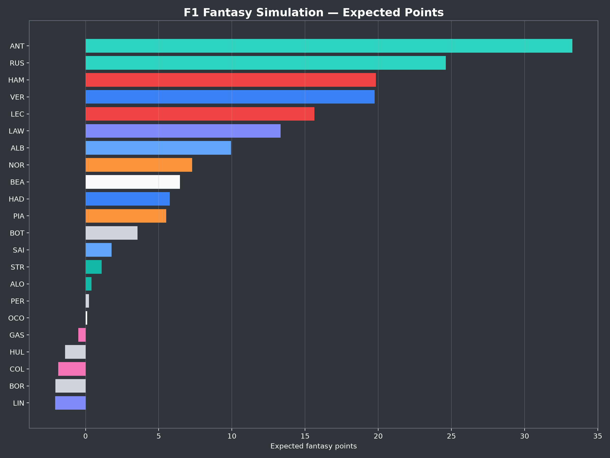

# F1 Simulation and Fantasy Model

Main local checkout: `C:\code_project\f1-sim`. See [Local workspace and automation](docs/local-workspace.md) for checkout provenance, backups and preserved Discord settings.

New local experiments: [race-window weather, qualifying pace, pit scenarios, track-rate and multiple safety cars/VSCs, shared team luck, sampled grids, grid penalties, sprints and survival modelling](docs/simulation-candidates.md). These candidates are unpromoted; live defaults remain unchanged. The [single degradation candidate](docs/single-degradation.md) counts tyre wear once, with a weight balanced against pace.

End-to-end Formula 1 race simulation and fantasy projection tooling.

The project loads FastF1 session data, builds driver pace and reliability features, blends current weekend signals with recent race baselines and trained historical-model calibration, runs Monte Carlo race simulations, estimates tyre strategy risk, calculates fantasy scoring, and exposes the workflow through both a CLI and a portable local pywebview app.

There is no Power BI custom visual implementation in this repository.

## Architecture Direction

`f1-sim` uses a hybrid architecture:

- Python owns FastF1 data collection, ML model training, race simulation prototyping, CSV/JSON generation, data reports, and Power BI prep.
- MATLAB/Simulink provides an optional lap-dynamics and strategy-validation workbench; it does not replace the production simulator.
- Rust and React/Tauri remain longer-term architectural options. The current
  downloadable beta uses Python, PyInstaller and pywebview; it does not require
  a Rust rewrite or a Node.js installation.

See [Architecture](docs/architecture.md).

## Quick Start

```powershell
python -m venv .venv
.\.venv\Scripts\Activate.ps1
pip install -r requirements.txt
python main.py --year 2026 --event latest --session Q --n-sims 5000 --no-discord
```

For the portable desktop app, Race Workbench:

Double-click **Launch F1 Sim.cmd** to open the Simulation Centre: launch Monte Carlo,
Simulink lap dynamics or scenario experiments, follow logs, and review saved runs.
See [Simulation Centre guide](docs/simulation-centre.md) for requirements and interpretation.

The new **Forecast next race** workflow automatically selects eligible inputs,
freezes a local forecast, and supports later race-result scoring. See the
[Windows beta guide](docs/windows-beta.md) for the packaged app, sharing-preview
export, and remaining public-release gates. No central uploads are enabled.

```powershell
python -m portable_app.web_main
```

To build the Windows portable app:

```powershell
pip install -r requirements-dev.txt
.\scripts\build_portable_app.ps1
```

The executable is written to:

```text
dist\RaceWorkbenchBeta-0.2.0-beta.1-r2\RaceWorkbenchBeta-0.2.0-beta.1-r2.exe
```

## Documentation

- [Setup](docs/setup.md)
- [Architecture](docs/architecture.md)
- [Development and run commands](docs/development-and-run-commands.md)
- [Run the portable app](docs/portable-app.md)
- [Automate session-aware forecasts on Windows](docs/automated-forecasts.md)
- [Data fields and inputs](docs/data-fields-and-inputs.md)
- [Parameter reference](docs/parameter-reference.md)
- [Outputs](docs/outputs.md)
- [Data sources](docs/data-sources.md)
- [Model design](docs/model-design.md)
- [MATLAB and Simulink validation](docs/matlab-simulink.md)
- [First Simulink experiment review](docs/matlab-first-review.md)
- [Data-source roadmap](docs/data-source-roadmap.md)
- [Output hygiene](docs/output-hygiene.md)
- [Backtest Discord output](docs/backtest-discord-output.md)

## Main Workflow

`main.py` runs the core pipeline:

1. Load the target event/session, or select the latest useful weekend session.
2. Export available weekend lap details.
3. Build current-session driver features and recent race baselines.
4. Add grid, weather, race-control, team reliability, and performance-profile signals.
5. Apply trained historical finish/DNF calibration when model artifacts are available.
6. Run Monte Carlo race simulations.
7. Calculate fantasy points and value metrics when prices are available.
8. Predict tyre strategies and optionally adjust them with same-event historical patterns.
9. Save snapshots for backtesting and generate report outputs.

## Active App Direction

The active desktop UI is the local web app wrapped with pywebview:

- Entry point: `portable_app/web_main.py`
- Python bridge/API: `portable_app/web_backend.py`
- Web assets: `portable_app/web/`
- App logo: `portable_app/web/logo.svg`; Windows icon `assets/race_workbench.ico` (rebuild with `python scripts/make_app_icon.py`)
- Shared services: `src/app_services/`

Older Tkinter/PySide GUI prototypes have been removed so the repository has one clear portable-app path.

## Generated Local Artifacts

These are intentionally ignored by Git:

- `outputs/`
- `build/`
- `dist/`
- `data/cache/`
- `data/historical_model/`
- `data/models/`

Create a new inactive historical model candidate with:

```powershell
python scripts/build_historical_dataset.py --start-year 2022 --end-year 2026 --sessions Q R
python scripts/train_historical_model.py --historical-dir data\historical_model --finish-target grid_residual
```

Training writes a unique folder under `outputs/model_candidates` by default and
preserves existing models. Historical calibration defaults to off; candidates
need independent promotion review before they can affect forecasts.

## Tests

	- `outputs/fantasy_expected_points.png`
    ### Fantasy expected points



	- `outputs/fantasy_value.png` (only when prices are available)
- Backtest outputs
### Fantasy value

	- `outputs/history/*prediction_snapshot*.csv`
	- `outputs/history/latest_prediction_snapshot.csv`
	- `outputs/history/*prediction_snapshot*.config.json`
	- `outputs/backtest/*_actual_results.csv`
	- `outputs/backtest/*_comparison.csv`
	- `outputs/backtest/*_metrics.csv`
	- `outputs/backtest/*_recommendations.txt`

## Visual behavior and interactions

Report/plot behavior currently implemented:

- Team-colored bars and dark-theme chart/report styling across chart modules.
- Simulation summary + strategy risk are rendered into report-card images.
- Tyre strategy output ranks multiple candidate plans and exposes score, score gap, and candidate summary columns.
- Historical strategy adjustment can overwrite default tyre strategy output when same-event history indicates likely higher stop counts.
- Discord posting sends:
	- One long summary message (auto-split to respect Discord length limits)
	- Then report files as attachments.

There is no interactive UI/field-well behavior in this repository; outputs are static images and CSV files.

## Formatting options

No user-facing formatting pane exists in the current implementation.
Formatting is controlled in code (matplotlib styles, table labels, color maps, output paths).

## Known limitations

- Tyre inventory is estimated from lap data and tyre-life heuristics, not official FIA/Pirelli barcode set tracking.
- Historical strategy adjustment depends on event matching and available historical race data quality.
- If current session is practice, grid is estimated and uncertainty is intentionally increased.
- Rainfall, forecast, and weather modifiers are conservative heuristics, not a full meteorological or circuit-specific calibration model.
- Engine/car reliability is inferred from recent result statuses and editable team/power-unit mappings, not an official manufacturer reliability feed.
- Fantasy value (`xPPM`) requires valid prices in `data/fantasy_prices.csv`.

## Troubleshooting

- `DISCORD_WEBHOOK_URL is missing. Add it to your .env file.`
	- Set `DISCORD_WEBHOOK_URL` in `.env`, or keep `POST_TO_DISCORD` disabled.
- `Snapshot not found: outputs/history/latest_prediction_snapshot.csv`
	- Run `python main.py` first to create a snapshot, then run backtest.
- `No laps found for ...`
	- FastF1 may not have that session yet, or the event/session identifier is unavailable.
- Strategy files are missing
	- Check that lap detail and tyre inventory outputs were created; strategy generation is skipped when upstream data is empty.
- Fantasy value chart is skipped
	- Fill numeric `fantasy_prices` values in `data/fantasy_prices.csv`.

## Documentation guard

`scripts/check-docs-updated.ps1` is a pre-commit helper that warns when staged code/config files changed but `README.md` was not staged.
It prompts for explicit override (`y`) before allowing the commit to continue.

## Recent implementation changes

The [qualifying, pace and retirement revision](docs/model-accuracy-revision.md)
uses official qualifying classifications for historical training/inference and
adds selectable single-pass pace and outcome-based retirement experiments.
Retirement distance can determine classification separately from pace. Replay
supports separate pace/reliability history lengths and checks source stability.
Experiments remain inactive pending the documented promotion gates.

Offline [prediction data enrichment](docs/prediction-data-enrichment.md) adds
FIA PDF extraction, original weather-run validation, start-delay labels,
pit/stint records and experimental practice/reliability training inputs.
The Model Training page can include downloaded practice sessions with timestamp
evidence that they preceded qualifying. Candidates remain inactive pending review.

New source forecasts resolve the physical circuit separately from the Grand Prix
name. Weather, race distance and historical strategy now respect relocated venues;
see [Circuit identity and validation](docs/circuit-identity.md).

## Known Limitations

The hourly PC automation can refresh FIA listings and extract verified grids and
explicit grid decisions. Local configuration, source captures and cutoff rules
are documented in [FIA document sync](docs/fia-document-sync.md).

Accuracy work and the reproducible offline benchmarks are documented in [Accuracy improvements](docs/accuracy-improvements.md). The matched-stint candidate remains disabled after failing its comparison with the current model. The qualifying/grid experiment improves diagnostic finish ranking but worsens podium probabilities; live grid weighting remains unchanged pending fresh validation. [Multi-score tuning](docs/multi-score-tuning.md) fits several simulation settings together against rank correlation, Brier and calibration error on held-out seasons, without changing live defaults. [Pace uncertainty](docs/pace-uncertainty.md) treats each car's pace as an estimate shared by teammates, which improves every whole-distribution score of the car-agent engine on the 2026 packet.

The hourly task can collect current-weekend practice and compare the stage blend, Q grid multiplier 3.3 and single pace blend in [prospective shadow trials](docs/prospective-prediction-trials.md). Results are scored against official classifications without changing live predictions or posting experimental outputs.

- Tyre inventory is estimated from lap/stint data, not official FIA/Pirelli barcode tracking.
- Weather, race-control, reliability, and tyre modifiers are modelled conservatively from available data and heuristics.
- Historical calibration depends on locally generated `data/models/` artifacts.
- Fantasy value output requires valid prices in `data/fantasy_prices.csv`.

## 2027 production release plan

The [2027 subscription product roadmap](docs/release-plan-2027.md) targets a conditional paid desktop pilot with hosted forecasts and a mobile companion on 6 March 2027. Native mobile apps and hosted personal simulations follow the pilot; data rights, billing, model evidence, security and recovery remain release gates.
