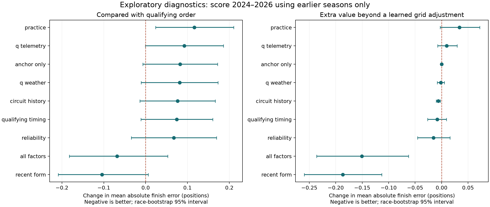
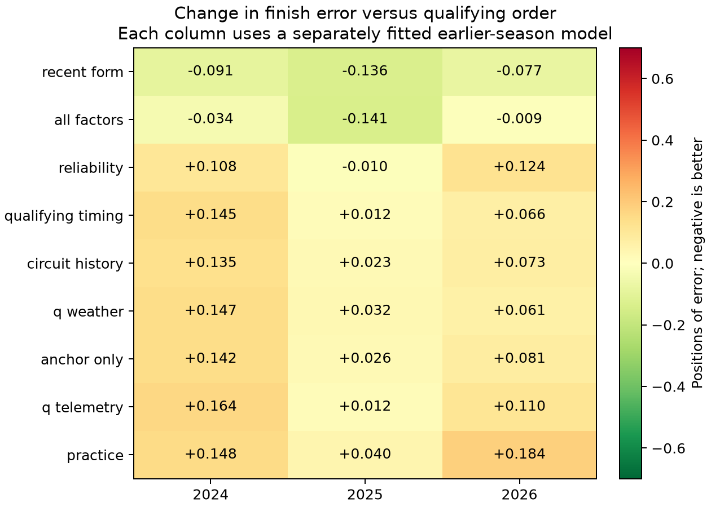

# Historical predictive factors: 24 October 2026

Recent team/driver form and earlier race pace are the strongest leads in the
available archive. The evidence supports narrower, stage-specific experiments,
not adding every input to the production predictor. Nothing was promoted.

## Coverage and method

The main checkout was fetched and verified current with GitHub at `9c761a1`.
The older OneDrive recovery copy was not edited. Analysis verified all **31,108
files** referenced by the 649 complete detailed-session pointers: **7.795 GB**,
**356,711 lap rows**, **288,172,992 car telemetry samples**, 131 race sessions
and 132 qualifying sessions. There were no integrity failures. Raw position
streams were hash-verified, not analysed as trajectories. Car streams were
summarised over sessions, not aligned to individual corners or clean laps.
This covers the committed detailed archive, not every retained cache/version.
The archive spans the 2018 Australian weekend and 2021–2026, with incomplete
session/season coverage explicitly recorded in the inventory.

The usable Q/R modelling table has **121 races and 2,420 driver outcomes**.
Nine races fail the complete official Q-rank contract; the aborted 2021 Belgian
classification is excluded. DNS/DQ rows are excluded from these model targets.
Consequently, scores describe eligible matched driver rows, not guaranteed
complete-field operational forecasts. Unknown retirement labels remain missing.

Training always precedes the scored season: train through 2023, score 2024;
train through 2024, score 2025; train through 2025, score 2026. The scored folds
contain **21, 22 and 15 races**, respectively. All are inspected historical
diagnostics, with zero fresh prospective confirmation races. There is no
hyperparameter search: Ridge alpha 100 and logistic C 0.1 are fixed. Imputation
and scaling are fitted only on training rows. Race-average scores give races
equal weight; uncertainty intervals resample whole races 3,000 times.

Practice requires a UTC envelope before Q, from lap UTC and/or the saved UTC
race-control messages. Missing lap UTC is common in older Q exports; missing
all ordering evidence excludes practice instead of assuming its availability.
These are retrospective timing bounds, not attested publication timestamps.
Q timing and observed Q weather are allowed; target race weather, race control,
final grid, result and retirement labels are not predictor inputs. Driver/team
histories update only after assembling the target's features. Rank ties use
driver identifiers, never the order of the race-result rows.

The initial pass which relied only on absolute lap UTC understated practice
availability and is retained as a diagnostic artifact. Use the final **r3**
report and its saved executed source. The follow-up attribution tests were
chosen after that first diagnostic pass. Multiple comparisons and model
limitations mean confidence intervals are exploratory, not discovery proofs.

## 1. Recent team/driver form is the best lead

Main Q comparison on the same 58 later races, scoring continuous finish estimates:

| Input family, in addition to qualifying rank | Finish MAE | Difference from qualifying order |
| --- | ---: | ---: |
| Qualifying order, without fitted adjustment | 3.089 | — |
| Recent driver/team form and earlier race pace | **2.985** | **−0.104 / −3.38%** |
| All investigated factors | 3.021 | −0.068 |
| Prior reliability features | 3.156 | +0.067 |
| Additional Q lap/sector/speed timing | 3.163 | +0.074 |
| Earlier circuit history | 3.165 | +0.076 |
| Observed Q weather | 3.170 | +0.081 |
| Learned grid adjustment alone | 3.172 | +0.082 |
| Whole-session Q telemetry summaries | 3.181 | +0.092 |
| Practice pace/coverage/confidence | 3.205 | +0.116 |

The recent-form family's change versus raw qualifying order has a 95% race
bootstrap interval **[−0.209, +0.006] positions**: a plausible improvement,
but not a settled win. A fitted grid adjustment alone actually worsens the raw
baseline. Beating that weaker adjusted baseline is insufficient for promotion.

The follow-up separates the useful inputs:

| Q input | 2024 MAE change vs Q order | 2025 | 2026 |
| --- | ---: | ---: | ---: |
| Recent team form only | −0.066 | −0.085 | −0.054 |
| Recent driver form only | −0.058 | −0.111 | +0.006 |
| Earlier race pace only | +0.006 | −0.088 | −0.037 |
| Driver + team form + earlier race pace | **−0.084** | **−0.131** | **−0.083** |

Team form is the most season-consistent individual lead. Driver history alone
does not hold up as well in 2026. The three-input combination scores 2.987 MAE,
with a change interval [−0.205, +0.007] versus raw Q order. These are proxies for
relative competitiveness, not causal estimates of driver ability or car quality.

Production implication: test an explicit grid-anchored form adjustment with
strong shrinkage, including current-season team state and earlier relative race
pace. The production model already uses recent pace, so these results do not
prove that adding another history term improves the existing simulation. A
controlled ablation against the same live model is still required.





## 2. Practice correlates with outcomes but adds little after Q

Mean within-race Spearman correlation with finishing position is **0.663** for
Q rank, **0.352** for matched FP2 pace, **0.166** for FP1 and **0.107** for FP3.
These are associations; the controlled comparisons above test incremental value.
FP2 pace covers only **50.2%** of modelling driver rows, FP1 51.9%, FP3 22.9%.

FP2 alone added to the Q anchor worsens the later score to 3.182 MAE. Adding all
practice features scores 3.205. The present representation therefore does not
justify allowing practice to overrule qualifying order. Unknown fuel, traffic,
mixed programmes and sparse matched stints remain unresolved.

Earlier-stage checks explicitly omit target qualifying features:

| Stage | Recent-driver-form order baseline | Form/pace model | Change |
| --- | ---: | ---: | ---: |
| PRE | 3.895 | 3.619 | −0.276 / −7.08% |
| FP2 | 3.895 | 3.602 | −0.293 / −7.52% |

These checks rank a fixed eligible historical roster, with chronological model
fitting. They do not reconstruct published PRE entry lists, and their comparator
is not the production simulation. Their ranked-order error is also different
from the continuous-estimate Q score above. The **incremental FP2 change versus
the same PRE model is just −0.017 positions**, interval **[−0.085, +0.056]**.
Most of the apparent early-stage gain comes from the historical form/pace model.

## 3. Broad retirement risk is more supportable than detailed causes

Among the modelling rows, 319 of 2,403 known labels are retirements: **13.28%**.
Of those, **207 / 319 = 64.9%** have unspecified cause; only 45 are labelled
mechanical and 67 non-mechanical. A further 17 outcome labels are unknown.
Classifications are not independent mechanical-cause investigations.

Retirements account for approximately **25.9% of total Q-order absolute error**
in this eligible dataset. Average error is 2.789 positions for finishers, 6.644
for mechanically labelled retirements, 7.537 for non-mechanical and 6.174 for
unspecified retirements. Outcome groups explain misses; they are not available
as pre-race predictors.

Simple Beta(1,9)-smoothed earlier same-season driver/team rates were tested
separately, with no target result in the rates:

| Retirement predictor | Race-average Brier | Training-prevalence comparator |
| --- | ---: | ---: |
| Training prevalence | 0.11149 | — |
| Earlier driver rate | 0.10958 | −1.72% |
| Earlier team rate | 0.10890 | −2.32% |
| Equal driver/team mix | **0.10887** | **−2.35%** |

The mix's change interval is [−0.00508, −0.00019]. It is a promising exploratory
result, with multiplicity and small-sample caveats. The simple prior should be
a mandatory comparator for any more elaborate retirement candidate. In the
main study, fitting all factors together actually worsened retirement Brier
to 0.11473. More features did not make a better probability forecast.

Production implication: improve cause coverage separately, test broad
time-varying risk first, and do not invent manufacturer-level mechanical effects
from 45 labelled cases across these seasons.

## 4. Telemetry volume is not the present bottleneck

Q telemetry p95 speed has mean within-race finish correlation **−0.020**;
Q speed-trap relative speed **−0.162**. Whole-session telemetry summaries do not
improve on the Q anchor here. Throttle/brake fractions depend on programmes,
circuit and sampling, so they cannot be interpreted as causal driving skill.
This does not rule out clean-lap-aligned, corner-specific telemetry features;
those were not tested. It does argue against prioritising more raw data volume
without a specific feature hypothesis.

## Weather and circuit limits

Observed Q weather and earlier circuit summaries did not establish a useful
finish-order gain beyond raw Q order. This is not evidence that race weather or
circuit characteristics are irrelevant. The tested simple linear representation
is limited, circuit samples are sparse, and a timestamped race-window weather
forecast history is missing. Actual race weather was diagnostic-only: the 58
scored races include 44 dry and 14 with observed rain. Do not turn that target
race label into a supposed pre-race weather predictor.

## Recommended next experiment

1. Compare a strongly regularised, stage-specific team/driver form adjustment
   against the current predictor on identical episodes. Keep Q rank as the
   anchor. Isolate its interaction with the already-tested degradation fix.
2. Compare the simple earlier-results retirement prior with the live retirement
   model, scoring Brier and calibration separately from finishing order.
3. Keep practice confidence conservative, especially after Q. Improve matching
   and programme identification before adding complexity or more telemetry.

Any selected candidate still needs a frozen prospective protocol, proper
probability scores and the existing promotion gates. The active cohort and live
defaults were not changed by this analysis.

## Reproduction and evidence

```powershell
.\.venv\Scripts\python.exe -m scripts.analyse_historical_factors --workspace "$env:LOCALAPPDATA\RaceWorkbench" --output-dir outputs/feature_ablations/NEW_FACTORS
.\.venv\Scripts\python.exe -m scripts.analyse_factor_followups outputs/feature_ablations/NEW_FACTORS --output-dir outputs/feature_ablations/NEW_FOLLOWUP
.\.venv\Scripts\python.exe -m scripts.report_historical_factors outputs/feature_ablations/NEW_FACTORS --followup outputs/feature_ablations/NEW_FOLLOWUP
```

An existing directory is refused by the analysis commands. `--telemetry-cache`
can reuse saved checksum-verified summaries, but still verifies every raw file.
Output includes the inventory, complete feature table, predictions, per-race and
per-year scores, confidence intervals, telemetry summaries, plots and HTML report.
No packages were installed or historical source files rewritten.

Final local evidence: `outputs/feature_ablations/20261024-historical-factors-r3`
and `20261024-historical-factor-followups-r2`. The primary report SHA-256 is
`a384488c3bc299afcbfc655789e8ae8cfbde6ba91642e9d3ed7a380c0fabd2c5`.
The saved `analysis_source.py` matches that report's executed-source hash;
the later optional family-selection interface does not change the default scores.
The final regression suite passed **828 Python tests** with five existing
deprecation warnings. The active prospective suite still passes verification.

Method references: [scikit-learn on leakage and training-only preprocessing](https://scikit-learn.org/stable/common_pitfalls.html),
[limitations with correlated feature importance](https://scikit-learn.org/stable/modules/permutation_importance.html).
Telemetry units and the provisional DRS-code interpretation follow the
[FastF1 car-data source documentation](https://github.com/theOehrly/Fast-F1/blob/main/fastf1/_api.py).
